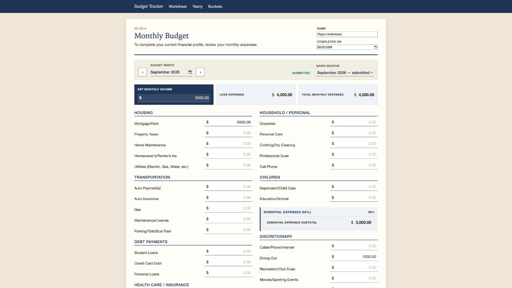
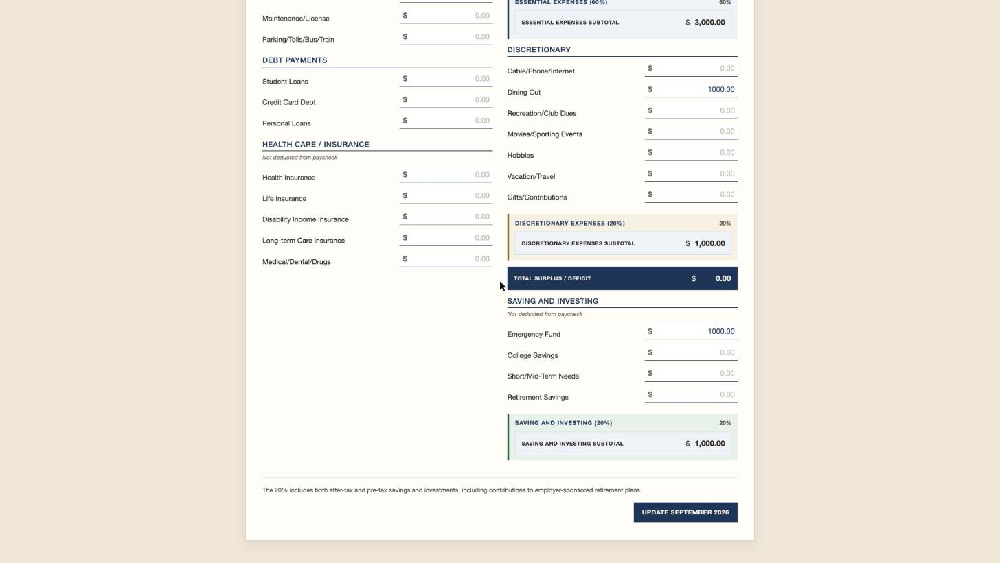
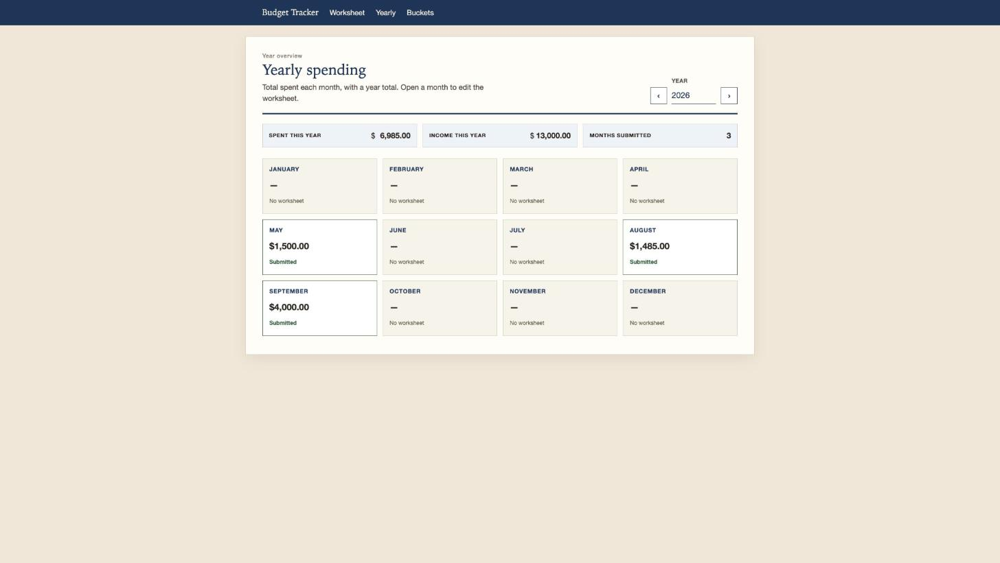
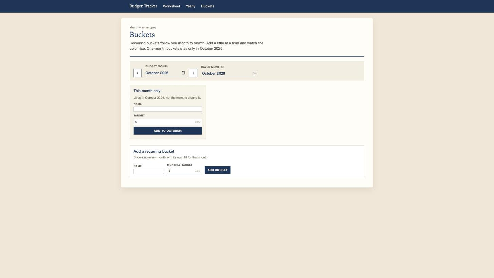

# Gallery

Screenshots from the hosted app on Azure App Service, using demo numbers.

### Worksheet
Enter a month's income and expenses.

### Worksheet totals
Each bucket is checked against its target: 60% essentials, 20% wants, 20% savings.

### Yearly
All twelve months at a glance, with yearly totals.

### Buckets
Savings envelopes, either recurring or for one month only.

